# Avelune

*Your rhythm. Your space.*

Avelune is a private, local-first period, ovulation, fertile-window and pregnancy tracker for **iPhone, Android and the web**,
with an optional **self-hosted, end-to-end encrypted sync server**.

> **A free, personal open-source project, not a paid product.**
> Avelune is not a company. There are no subscriptions, ads, in-app purchases or premium features, and there never will be. Anyone is free to use it.
>
> Technology today is a necessity for everyone, and understanding your own body should not depend on paying a monthly or yearly
> subscription. Avelune was created to add real value for people who cannot pay for one, or would rather not.
>
> **If you have the ability to contribute to this project and support it for the community, please go ahead.** See [CONTRIBUTING.md](CONTRIBUTING.md).
>
> Avelune is **not a medical device** and must not be used as contraception or to diagnose anything. By using it you agree to the
> [terms of use](TERMS.md) and [privacy policy](PRIVACY.md). The app shows the same notice the first time it opens.

## Screenshots

| | | | |
|:-:|:-:|:-:|:-:|
| 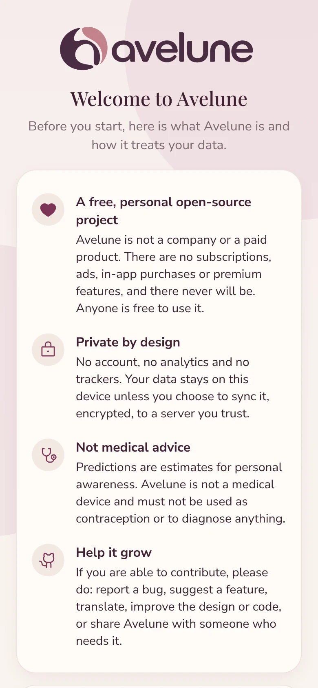<br>First-use notice | 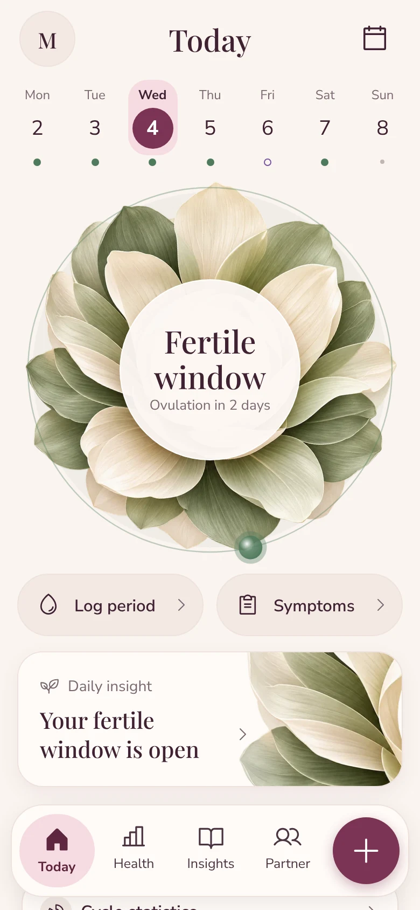<br>Today | 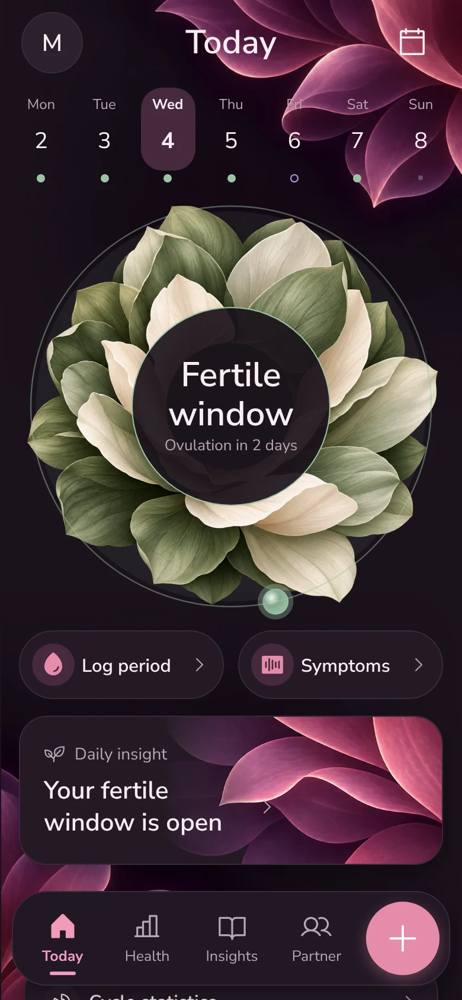<br>Dark mode | 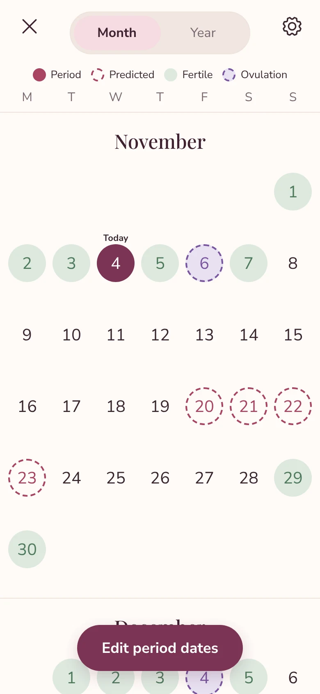<br>Calendar |
| 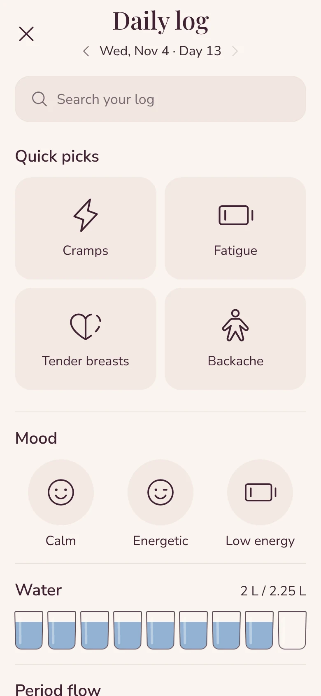<br>Daily log | 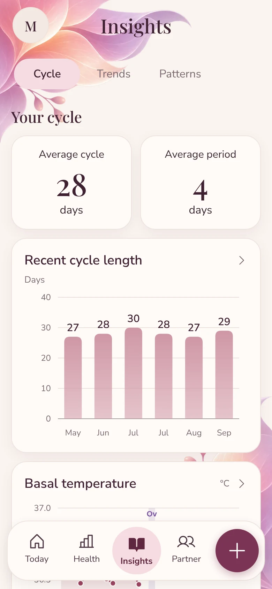<br>Insights | 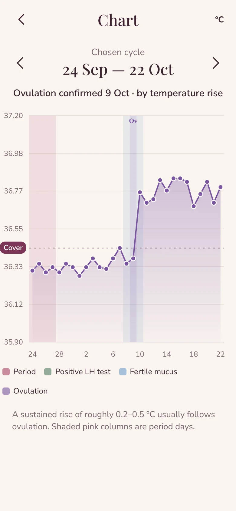<br>Temperature &amp; ovulation | 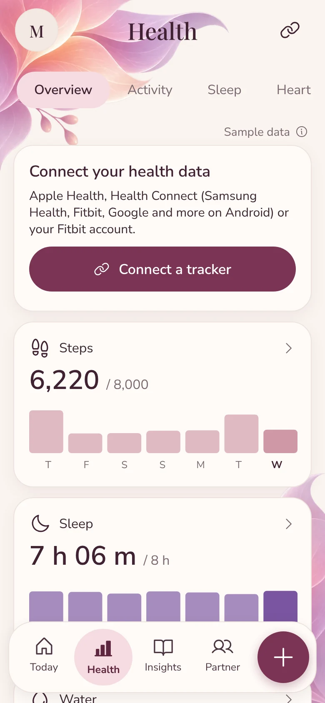<br>Health |
| 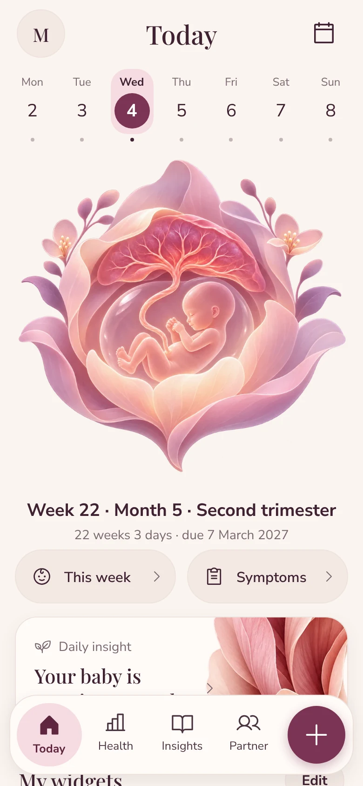<br>Pregnancy | 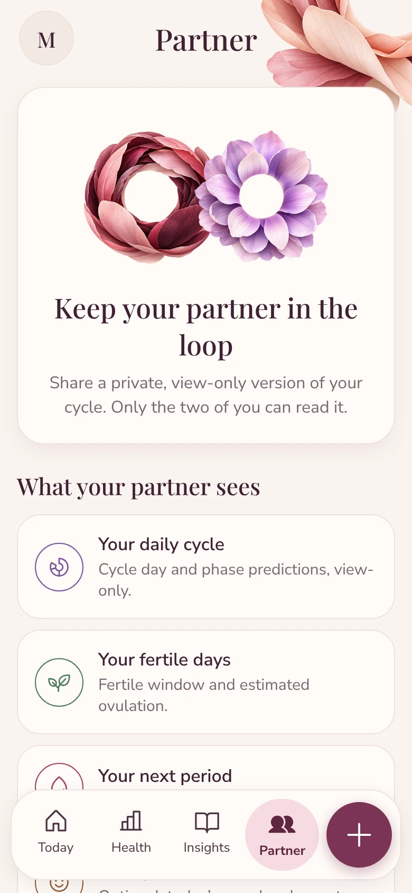<br>Partner sharing | 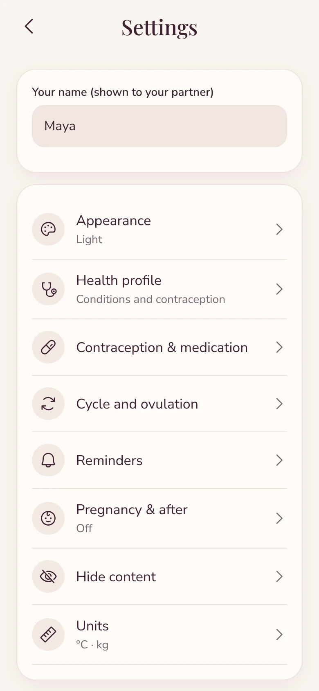<br>Settings | |

<sub>Screenshots from the web build with made-up demo data.</sub>

## Features

- **Works fully offline.** All data is stored on the device. No account is needed.
- **Today:** swipeable week strip, a breathing status circle ("Period in 5 days", "Ovulation in 3 days", "Late for 2 days") on a phase-tinted animated background, quick actions, daily tip cards.
- **Calendar:** Month / Year views, period, predicted, fertile and ovulation styling, optional cycle-day numbers, "Edit period dates" mode.
- **Daily log:** search, quick picks, flow, sex & sex drive, mood, symptoms, discharge, tests, pill, other, activity, water glasses, BBT, weight, sleep, distance, notes.
- **Graphs & reports:** cycle-length history, BBT with automatic ovulation (temperature-shift) detection, weight, activity, water vs target, sleep, most-logged symptoms and moods.
- **Pregnancy mode:** a growth illustration for each month of pregnancy, week and day, trimester, due date, and week-by-week notes.
- **Health:** Apple Health (iOS), Health Connect (Android, which also covers Samsung Health, Fitbit and Google), or Fitbit account sign-in. A dedicated Health page with Samsung-style icon navigation, Days/Weeks/Months charts and a cycle-phase overlay. Health data stays on the device.
- **Home widgets:** 12 animated widgets (cycle stats rings, steps, sleep, heart, weight, temperature with phases, water, activity, mood, symptoms, SpO₂), with add, remove and reorder.
- **Partner (view-only):** share a live, end-to-end encrypted view of your cycle with one person via an invite code; revoke any time. No chat, community or social features.
- **Reminders (iOS/Android):** period soon/start/end, ovulation, fertile window, pill, water, weight, sleep, temperature, daily check-in; discreet wording by default.
- **Import and export (Excel or CSV):** Settings → Your data. Export saves a real Excel (.xlsx) file in the same columns as the import template, so it can be imported again. Import accepts Excel (.xlsx) or CSV with one row per day (date, flow, symptoms, mood, BBT, weight, water, sleep, notes, steps) or one row per period (start, end). Delimiters `,` `;` tab; day-first or month-first dates detected (or chosen); °F and lb converted; common symptom names from other apps mapped; a preview shows what will change before anything is written, and existing entries are kept unless you choose to replace them.
- **Privacy:** no account, analytics or trackers; app lock and screenshot blocking; optional end-to-end encrypted sync to your own server; encrypted backups; hide sex content; JSON export and a PDF report for your doctor.

The full list of screens and features is in [docs/FEATURES.md](docs/FEATURES.md).

## Design

Brand tokens, typography and accessibility rules: [`design-system/avelune/MASTER.md`](design-system/avelune/MASTER.md). Latest audit: [`docs/design-audit.md`](docs/design-audit.md). Health page, widgets and motion: [`design-system/avelune/pages/health.md`](design-system/avelune/pages/health.md).

### Health integrations
- **Apple Health:** native HealthKit (needs an iOS dev build; not available in Expo Go).
- **Health Connect (Android 8+):** reads data written by Samsung Health, Fitbit, Google apps and most wearables. In Samsung Health, enable Settings → Health Connect.
- **Fitbit account:** OAuth 2.0 + PKCE straight from the device. Create a free "Client" app at dev.fitbit.com, set the redirect URL shown in the app, and paste its Client ID in Health → Connections.
- Google Fit's APIs are retired; Health Connect is the supported route.

## Layout

| Path | What |
|---|---|
| `packages/core` | Shared TypeScript: prediction engine, date helpers, sync merge rules (tested) |
| `server` | Fastify + SQLite: register/login, `/api/sync`, serves the web build (tested) |
| `app` | Expo / React Native app for iOS, Android and web |

## Run the server + web app (Docker)

```sh
docker compose up -d --build
# open http://localhost:8787  (put it behind HTTPS for anything beyond your LAN)
```
Data lives in the `avelune-data` volume. After creating your account(s) set `ALLOW_REGISTRATION: "false"`.

Without Docker: `npm install && npm run web:build && npm run server` (Node 22).

## Run the mobile apps

```sh
npm install
cd app
npx expo start            # scan the QR code with Expo Go on iPhone or Android
```
Standalone builds: `npx eas build -p android` / `-p ios` (iOS needs an Apple developer account), or
`npx expo run:android` / `run:ios` locally (Android SDK / Xcode required).
In the app: **Settings → Cloud sync → enter your server URL → create account / sign in.**
On a phone use your server's LAN IP or public HTTPS URL (not `localhost`).
A new device can restore by tapping **"I already use an Avelune server"** on the first screen.

## Develop

```sh
npm test            # core + server tests
npm run typecheck
```

## Encryption design

```
passphrase ──scrypt(N=2^14,r=8,p=1, public salt)──▶ master ──HKDF──▶ encKey  (XChaCha20-Poly1305)
                                                           └─HKDF──▶ idKey   (HMAC-SHA256)
```
- You choose an **encryption passphrase** (≥10 chars, must differ from your account password). It never leaves the device.
- Each record (a day log, the settings, or a deletion) is encrypted with a fresh random nonce. The ciphertext is bound to its record id (AEAD associated data), and the real timestamp is repeated inside the ciphertext, so a malicious server cannot swap, relabel or silently alter records.
- Record ids are `HMAC(idKey, "day:2026-10-01")`, so the server cannot see which dates you logged.
- The server stores the public salt + KDF cost + an encrypted key-check blob (set once) so a new device can verify the passphrase before syncing. Wrong passphrase → rejected.
- The derived key is kept in the iOS Keychain / Android Keystore (`expo-secure-store`); on web it falls back to `localStorage`.
- Crypto uses audited pure-JS `@noble/ciphers` and `@noble/hashes`, so it behaves identically on web, iOS and Android.

**Partner sharing:** the owner encrypts a small snapshot (cycle day, phase, predictions, a 70-day calendar strip, optionally today's mood/symptoms) with a random key. The invite code carries the server URL, a random share id and that key. The server stores only the ciphertext; the partner needs no account. Notes, sex logs and measurements are never shared.

**What the server can still see:** your email, when you sync, how many records you have, and when each was last edited (needed for last-write-wins). It cannot see content or which days you logged.
**Not protected:** a compromised device or browser; the web build's key in `localStorage` is readable by any script on that origin, so only use the web app on devices you trust.
**Recovery:** there is none by design. Lose the passphrase and synced data is unreadable (local data on your devices is unaffected; export JSON regularly).

## Privacy and security notes

- Account passwords are hashed with scrypt; session tokens are stored hashed; auth and sync routes are rate-limited.
- Use HTTPS in front of the server for anything beyond your LAN.
- Not yet implemented: password reset, multi-factor auth, passphrase change/key rotation.
- All in-app articles, tips and pregnancy notes are original, general information and not medical advice.

## Build the Android APK

GitHub → **Actions → Android APK → Run workflow**. When it finishes, download `avelune-android-apk` from the run page,
unzip it and install `app-release.apk` on your phone (allow "install unknown apps").
The generated project signs release builds with Expo's debug keystore, which is fine for sideloading but not for Play Store
upload; for that, configure your own keystore. Locally (Android SDK + JDK 17 required):
`cd app && npx expo prebuild --platform android && cd android && ./gradlew assembleRelease`.

## Build the iOS app

GitHub → **Actions → iOS build → Run workflow** compiles the app on a macOS runner, with no Apple developer account needed:

- `avelune-ios-unsigned-ipa`: a Release build for real iPhones. It is **not signed**, so an iPhone will not install it as is.
  Install it with a sideloading tool that signs it with your own Apple ID (for example Sideloadly or AltStore; with a free Apple ID
  the app must be refreshed every 7 days), or sign it with an Apple Developer account.
- `avelune-ios-simulator`: a Release build for the iOS Simulator. On a Mac with Xcode, unzip it and drag `Avelune.app` onto a running simulator.

For TestFlight or the App Store you need an Apple Developer account ($99/year) and a signed build, for example with
`npx eas build -p ios`. Locally on a Mac (Xcode 16 required): `cd app && npx expo run:ios`.

## Contributing

Bug reports, ideas, code, design, translations and testing are all welcome. Please read [CONTRIBUTING.md](CONTRIBUTING.md).
The most important rules: keep it private (no analytics or trackers), keep it free (no paywalls), and be honest that predictions are estimates.

## License, terms and privacy

- Code: [MIT License](LICENSE). Free to use, copy, modify and share.
- [Terms of use](TERMS.md) and [privacy policy](PRIVACY.md), generated from [`app/src/legal.ts`](app/src/legal.ts), the same text the app shows on first use and in **Settings → About Avelune**.
- Avelune is provided as is, without warranty. It is an independent project, not affiliated with any other tracking app or health service.
